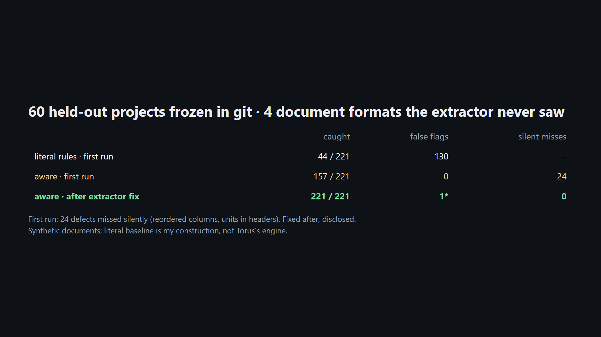

# Cross-document checks that know the code, not just "A ≤ B"

Unofficial prototype by Kushagra Pratap Singh. Not affiliated with Torus.

## The problem

[Torus](https://www.usetorus.com) reads a capital project's specs, drawings and datasheets and flags values that disagree across documents, e.g. relief set point vs design pressure, transformer rating vs connected load, code edition vs project spec. Every flag carries the rule that fired.

The hard part is that many of these checks aren't literal comparisons:

- **Relief set pressure** is limited by the vessel's **MAWP**, not its design pressure. MAWP is often 5–15% higher. With two valves, the second may be set up to **105% of MAWP**; a supplemental fire-case valve up to **110%** (ASME VIII-1 UG-134, 2019 ed.; Section XIII from 2021).
- **Transformers** are sized on **maximum demand** (continuous + a share of intermittent, standby excluded), against the **ONAF** (fan-cooled) rating. Connected load vs nameplate ONAN over-flags.
- **Pipe class** ratings **drop with temperature**: Class 150 Group 1.1 is 285 psig at 100 °F but 200 psig at 400 °F (ASME B16.5-2020 Table 2-1.1). A line at 250 psig / 400 °F looks fine against "Class 150 = 285".
- **Gauge vs absolute**: 115 psia is 100.3 psig.
- Spec text matters: "API 610 11th Edition **or later**" accepts a 12th-edition datasheet. Driver sizing has API 610 margins (125% / 115% / 110% by power), and NPSH has a project margin.

Get these wrong one way and engineers drown in false flags. Get them wrong the other way and a real problem passes.



## What I built (stdlib only)

- **`crosscheck/project.py`**: synthetic project document sets (~11 text docs each): vessel datasheets (3 layouts), process datasheet, PSV list, line list, piping material spec, vendor pump datasheets, transformer datasheets, load list, project spec, document register. Units, tag spellings (`PSV-101A` / `PSV 101A` / `PSV101A`) and key spellings vary. Each project gets 2–5 planted **defects** and 3–6 planted **look-alikes**: values a literal check flags that are fine by code or spec.
- **`crosscheck/units.py`**: psig / psia / barg / bara / kPa(g) / kg/cm²(g) / °F / °C / kVA / MVA / kW / hp / m³/h / gpm / ft / m.
- **`crosscheck/checks.py`**: extraction into a project model (every value keeps its source line), then two rule sets:
  - **aware**: 10 checks with the engineering context above, each flag citing its rule.
  - **literal**: the same comparisons read literally (set ≤ design pressure, connected ≤ nameplate, edition ==, class rating at ambient, gauge/absolute ignored). This is my construction of a naive baseline, **not Torus's engine**.
- A value the checker can't read becomes an **UNREAD** item for a person instead of a silent pass.

## Results

| | planted defects caught | false flags | silent misses |
|---|---|---|---|
| dev (40 projects) · aware | 137/137 | 0 | 0 |
| dev · literal | 68/137 | 142 | – |
| **held-out (60 projects, 4 unseen document variants), first run** · aware | **157/221** | **0** | **24** |
| held-out, first run · literal | 44/221 | 130 | – |
| held-out after extractor fix · aware | 221/221 | 1* | 0 |
| held-out after extractor fix · literal | 98/221 | 227 | – |

The held-out set (seeds 9001–9060) was frozen in git before its first run. It adds four document variants the extractor wasn't written for: units in column headers (`Design pressure (barg): 36.20`), kg/cm²(g), reordered PSV-list columns, and a new transformer phrasing.

**What the first run showed:** the unseen formats cost 64 defects. 40 were reported as UNREAD, but **24 were silent**. Reordered columns and one-line vessel rows were read into the wrong fields without any warning. That's the failure mode that matters most for a tool engineers trust. The fix (disclosed, after the run) reads CSVs by header name, reads units from keys, adds kg/cm²(g), and never attaches a line to the previous tag. Outputs: `out/heldout_first_run_stdout.txt`, `out/heldout_after_fix_stdout.txt`.

\* The one "false flag" after the fix is a labeling error in my generator, and the checker is right. The look-alike was built against the first relief valve, but the vessel's second valve is set lower (325 psig), and the lowest set pressure governs.

**Honest limits**
- Synthetic documents, and I wrote both the generator and the rules, so dev-set perfection says little. The held-out variants are the real test, and they broke the first version.
- Ten check families, not fifty. No drawings or P&ID images, only text and tables.
- Code values (UG-134 limits, B16.5 table, API 610 driver margins) should be verified against the current editions before use. The demand factors come from the project spec, which is a firm convention.

## Run it

```
python demo.py                    # one held-out project: flags with sources + rule, literal comparison
python evaluate.py heldout        # full table
python -m unittest discover -s tests
```
